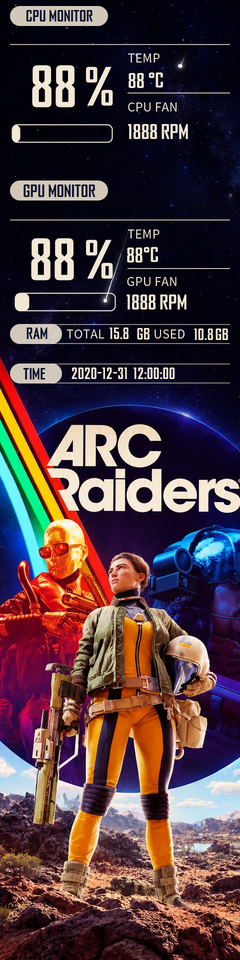

# Lian Li 8.8" Universal Screen – custom templates

Fan-made templates and a small toolkit for the **Lian Li 8.8" Universal Screen** (US88v1) in **L-Connect 3**.
Give any built-in template a new (animated) background while keeping its layout and live sensor data.

🇳🇱 [Nederlandse uitleg staat hieronder](#nederlands).



## Templates

| Template | Based on | Orientation | Download |
|---|---|---|---|
| **ARC Raiders – Samurai** | built-in "samurai" (88016_) | portrait | see [Releases](../../releases) |

Animated starfield with shooting stars, CPU/GPU load, temperatures, fan speeds, RAM, date and time.

## Install a template

1. Download the `.zip` from [Releases](../../releases). **Do not unzip it.**
2. Open L-Connect 3 → **Universal Screen** → **LCD Screen Setup** → **Template**.
3. Make sure the screen is in **portrait** orientation.
4. Click the **"+"** tile, select the ZIP.
5. Select the new template and click **Apply**.

## Make your own

Requirements: Python 3.9+, [ffmpeg](https://ffmpeg.org/) on your PATH, and

```bash
pip install -r requirements.txt
```

Copy a built-in template from `C:\ProgramData\Lian-Li\L-Connect 3\universal-screen-8.8-inch\template\`
(the preview images in `...\preview\` show which is which), then:

```bash
python tools/build_template.py --base 88016_.template --background my_image.jpg \
    --name My_Template --stars --shift-up 75
```

| Option | Meaning |
|---|---|
| `--background` | image (jpg/png) or video (mp4), ideally 480×1920 portrait – other sizes are cropped |
| `--stars` | add looping shooting stars (images only) |
| `--star-zone` | start and target area of the stars: `sx1,sy1,sx2,sy2,tx1,ty1,tx2,ty2` |
| `--shift-up N` | move the whole info block N pixels up |
| `--text-color`, `--label-color`, `--overlay-color` | hex colours for text, pill labels and pills/lines |
| `--scrim` | darkening behind the info block (1.0 = none) |

The result is a ZIP in `out/<name>/` that you import with the "+" tile. `preview.png` shows what it will look like.

`tools/inspect_template.py file.template` lists every field of a template (type, position, data source, font, colour).

## How it works

A `.template` is a .NET BinaryFormatter file. The video is **not** embedded – it is referenced by name, which is why
the import ZIP contains both the `.template` and a raw `.h264` stream (24 fps, no B-frames, like L-Connect creates itself).
Details: [docs/template-format.md](docs/template-format.md).

Tested with L-Connect 3 **v2.1.29**. Other versions or templates may behave differently – issues welcome.

## Credits & legal

- **ARC Raiders** and its artwork are © **Embark Studios**. This is an unofficial fan project, not affiliated with or endorsed by Embark Studios.
  The artwork is only included in the release download, for personal non-commercial use. If you are a rights holder and want it removed, please open an issue.
- Layouts are derived from the built-in templates of **Lian Li L-Connect 3** © Lian Li Industrial Co., Ltd. This project is not affiliated with Lian Li.
- No fonts are included; templates use the fonts that ship with L-Connect 3.
- The **code** in this repository is MIT-licensed (see [LICENSE](LICENSE)). The license does not cover third-party artwork or Lian Li's assets.

---

## Nederlands

Fan-made templates en een kleine toolkit voor het **Lian Li 8.8" Universal Screen** in **L-Connect 3**.
Geef een standaardtemplate een eigen (bewegende) achtergrond, met behoud van de layout en de live gegevens.

### Template installeren

1. Download de `.zip` via [Releases](../../releases). **Niet uitpakken.**
2. Open L-Connect 3 → **Universal Screen** → **LCD Screen Setup** → **Template**.
3. Zet het scherm op **staand** (portrait).
4. Klik op de **"+"**-tegel en kies de ZIP.
5. Selecteer de nieuwe template en klik op **Apply**.

### Zelf maken

Installeer Python 3.9+, ffmpeg en `pip install -r requirements.txt`. Kopieer een standaardtemplate uit
`C:\ProgramData\Lian-Li\L-Connect 3\universal-screen-8.8-inch\template\` en voer uit:

```bash
python tools/build_template.py --base 88016_.template --background mijn_afbeelding.jpg \
    --name Mijn_Template --stars --shift-up 75
```

De ZIP verschijnt in `out/<naam>/`; `preview.png` laat zien hoe het eruit komt te zien. Alle opties staan in de Engelse tabel hierboven.

### Rechten

ARC Raiders-artwork © Embark Studios; layouts gebaseerd op templates van Lian Li. Dit is een onofficieel fanproject.
De code valt onder de MIT-licentie; die geldt niet voor artwork of materiaal van derden.
